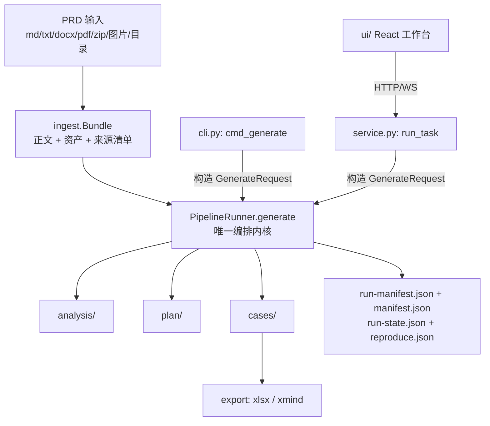
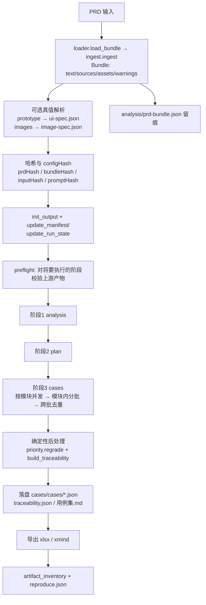

# prd2tc 总体架构

> 基准：`prd2tc` 0.5.0（`src/prd2tc/__init__.py:7`）。本文所有结论均来自本仓库源码与测试，引用格式为 `相对路径:行号`。
> 规模数据会随代码与测试变化；测试数量以当前分支实际执行结果为准。本文重点描述模块边界与数据流，不把历史行数当作质量指标。
> 阅读顺序建议：先看 §1 定位与 §3 数据流，再回看 §2 模块地图与 §4 设计决策。

---

## 1. 定位与非目标

### 1.1 一句话定位

`prd2tc` 把一份 PRD 变成**可评审的 Markdown + 可机读的结构化用例 JSON**：

| 阶段 | 输入 | 输出 | Prompt 资产 |
| --- | --- | --- | --- |
| 1 需求分析 | PRD 全文（+ 图片证据 + 参考示例） | `analysis/需求分析报告.md`、`analysis/requirements.json` | `prompts/01-prd-analysis.md`（`stages.py:26`） |
| 2 测试方案 | 需求分析报告（紧凑版） | `plan/测试方案.md` | `prompts/02-test-plan.md` + `templates/test-plan.template.md`（`stages.py:27,29`） |
| 3 用例生成 | 测试方案 + 结构化需求（按模块分批） | `cases/用例集.md`、`cases/cases/<MODULE>.json`、`cases/traceability.json`、`.xlsx`/`.xmind` | `prompts/03-test-cases.md`（`stages.py:28`） |

它是**独立可发布**的工具：不依赖本地 agent、不依赖第三方 Python 库，可放进 CI 无人值守运行（`README.md:8-9`）。

### 1.2 三条使用路径

三者的**能力上限相同**，差别只在交互形态：

| 路径 | 入口 | 适用 | 关键实现 |
| --- | --- | --- | --- |
| CLI（推荐） | `prd2tc generate/export/diff/merge/validate/stats/compare-runs/...` | 线上、CI、批量 | `cli.py:35` `cmd_generate` 等子命令，解析器见 `cli.py:289` |
| FastAPI 服务 | `create_app()`，`uvicorn 'prd2tc.service:create_app' --factory` | 团队协作、阶段审阅、实时进度 | `service.py:246`，路由与 WebSocket 见 `service.py:443-1005` |
| React 工作台 | `ui/`（Vite + React + antd） | 人工评审、Markdown 预览、产物下载 | 通过 HTTP/WS 消费服务：`ui/src/api.ts`、`ui/src/hooks.ts` |

服务模式是**可选依赖**，核心 CLI 不因此背上第三方包：

```toml
# pyproject.toml
[project.optional-dependencies]
service = ["fastapi>=0.110", "uvicorn>=0.29", "websockets>=12", "python-multipart>=0.0.9"]
```

`websockets` 被显式列为必需项，因为缺它时 uvicorn 无法完成 WebSocket 升级，实时进度会静默退化成 10s 轮询（`pyproject.toml` 注释；`service.py:385-397` 的心跳线程就是为「长耗时期间不让 UI 误判卡死」而存在）。

### 1.3 三条路径的关系



**关键点**：CLI 与服务都不是「另一套实现」，而是同一个 `PipelineRunner.generate()` 的**适配器**——CLI 负责 argv→`GenerateRequest` 与打印，服务负责上传/任务存储/审阅状态/WS 事件。二者的差异只体现在回调上：

- CLI：`PipelineRunner(cfg, llm=...).generate(request, progress_callback=progress)`（`cli.py:95`）
- 服务：`runner.generate(req, progress_callback=progress, event_callback=on_event)`（`service.py:399`）

历史痕迹也印证了这次收敛：`cli.py:16` 仍保留 `S = stages  # 兼容既有调用方；生成编排已迁移至 PipelineRunner`。

### 1.4 非目标（明确不做什么）

| 非目标 | 说明与依据 |
| --- | --- |
| 不执行测试 | 只**消费**执行结果契约，不做浏览器驱动。`execution.py:1` 定位为「与 02-Playwright-Automation 对接的执行结果契约」；`apply_execution_results` 仅把 `lastExecution` 附加到用例副本（`execution.py:54-78`） |
| 不改写 PRD | 图片只作为证据读取、不注入正文（`images.py:25`「只读，不改 PRD」）；摄取层做归一化但不回写源文件（`ingest.py:22-23`） |
| 不做向量检索 | 示例库检索是零依赖的轻量打分（`examples.py:70-91`）；语义检索在 README 中被列为**演进方向**而非现状 |
| 不承诺字节级复现 | 结构级复现（模块集合/需求数/用例数/覆盖率/门禁）才是可达契约（`reproduce.py:3-7`） |
| 不把 Markdown 当机读事实源 | 导出「共同数据源为 `cases/cases/*.json`，与 Markdown 评审稿同源，不读 Markdown」（`export/__init__.py:4-5`） |
| 不引入运行时第三方依赖 | 见 §4.2 |
| 不提供插件/注册表机制 | 阶段、门禁、导出都是**显式枚举**而非动态发现（见 §5 扩展点） |

---

## 2. 模块地图

分组原则：**入口层**只做协议适配；**编排层**决定「跑什么、按什么顺序、产物算不算数」；**能力层**是无状态或近无状态的领域逻辑；**产物层**负责落盘格式与契约；**基础设施**被所有层依赖。

### 2.1 入口层（3 个模块 + 前端）

| 模块 | 一句话职责 | 关键公开函数（行号） |
| --- | --- | --- |
| `__init__.py` | 包标识与版本号（`0.5.0`） | `__version__`（`:7`） |
| `cli.py` | argparse 子命令 → `GenerateRequest` → 打印/退出码；文件型工具命令（validate/stats/export/diff/merge） | `cmd_generate:35`、`cmd_export:186`、`cmd_diff:238`、`cmd_compare_runs:273`、`build_parser:289`、`main:337` |
| `service.py` | 可选 FastAPI 适配层：上传/工作区、任务状态机、阶段审阅与重跑、WS 实时事件 | `create_app:246`、`run_task:341`、`regenerate_stage:803`、`resume_run:877`、`events_ws:981` |
| `ui/`（TS/React，非 Python 模块） | 工作台：PRD 版本管理、阶段草稿与显式审批、实时事件、追踪矩阵、导出 | `ui/src/api.ts`、`ui/src/pages/*.tsx`、`ui/src/test/*.test.tsx` |

服务层**不重复实现生成逻辑**：它把请求序列化进 `task.json`（`service.py:287-305`，含 `attachments`/`image_dirs`/`fetch_images` 等字段），再交给 `PipelineRunner`；重跑阶段时丢弃「该阶段及其下游」产物与检查点后，用 `resume=True` 复用上游（`service.py:797-853`）。

### 2.2 编排层（4 个模块）

| 模块 | 一句话职责 | 关键公开函数（行号） |
| --- | --- | --- |
| `pipeline.py` | **唯一编排内核**：哈希、清单、preflight、三阶段调度、检查点、门禁失败处置、导出触发 | `GenerateRequest:27`、`RunResult:61`、`PipelineRunner.generate:220`、`cancel:215`、`extract_version:73` |
| `stages.py` | 三阶段的提示词组装、LLM 调用、长文档分段与合并、批次切分、跨批去重、门禁重试循环 | `generate_stage_1:1172`、`run_stage_2:1257`、`run_stage_3_modules:784`、`run_stage_3:1300`、`generate_with_feedback:1317`、`requirements_from_analysis:582`、`dedup_cross_batch:732`、`stage3_repair_builder:364`、`_module_batch_size:338` |
| `artifacts.py` | 阶段产物的**唯一契约**：依赖图、完备性规则、陈旧检测、`--stage/--from-stage` 语义 | `Artifact:37`、`STAGE_INPUTS:75`、`STAGE_OUTPUTS:80`、`check_one:155`、`read_manifest_hash:140`、`stages_to_run:214`、`format_problems:195` |
| `profiles.py` | 领域 Profile 的默认模块与覆盖阈值（不限制动态模块发现） | `PROFILES:4`、`get_profile:14` |

`profiles.py` 只有 18 行，但它是「默认值来源」而非「模块白名单」：`generic` 给 `["COMMON","PERF"]`，`ecommerce` 给 12 个模块；真正的模块集合由阶段 1 从 PRD 动态发现（`stages.modules_from_analysis:692`），并在阶段 3 以 `allowed = {module}` 逐模块强制（`stages.py:861`）。注意：当前代码**只读取** `profile["minCasesPerRequirement"]`（`pipeline.py:226`、`cli.py:58`），`modules` 字段没有任何消费方（见 §7 第 7 条）。

### 2.3 能力层（19 个模块）

#### 2.3.1 输入获取与设计真值（5）

| 模块 | 一句话职责 | 关键公开函数（行号） |
| --- | --- | --- |
| `loader.py` | PRD/prompt/template 资源装载：仓库内文件优先、安装包资源兜底 | `load_bundle:46`、`load_asset:22`、`load_prd:39`、`_common_base:88` |
| `ingest.py` | 多格式多文件摄取 → `Bundle(text, assets, sources)`：md/txt/docx/html/pdf/zip/图片/目录 | `ingest:694`、`sniff_kind:171`、`decode_text:214`、`extract_docx:318`、`extract_pdf:449`、`Bundle.fingerprint:154`、`to_json:975` |
| `images.py` | PRD 图片发现→关联→视觉分析→缓存，产出 `image-spec.json`（证据分级 `inferred`） | `discover_refs:135`、`resolve_refs:319`、`analyze_images:475`、`prepare_from_assets:552`、`render_image_spec:670`、`to_json:736` |
| `prototype.py` | 把可运行原型（HTML/JS）解析为 **UI 契约**：真实 `data-testid`/页面/页签/弹窗/文案/路由 | `extract_ui_spec:432`、`parse_prototype:484`、`merge_specs:494`、`render_ui_spec:567`、`validate_targets:720` |
| `chunking.py` | Markdown 感知分段（稳定字符偏移 + 标题路径）与关键词定位 | `split_document:20`、`locate:75`、`Chunk:9` |

这两个「真值模块」解决的是同一类缺陷：**设计真值不可达时模型必然编造**。原型侧实测编号 `c653dc92`：PRD 中 `data-testid` 出现 0 次，模型产出 143 个自拟标识符与原型中不存在的 URL 路由（`prototype.py:8-11`、`pipeline.py:116-118`）；图片侧实测真实 PRD 含 8 处图片引用却从未参与生成（`images.py:9-12`）。

#### 2.3.2 模型输出的解析、校验与加工（10）

| 模块 | 一句话职责 | 关键公开函数（行号） |
| --- | --- | --- |
| `schema.py` | 用例 Schema 版本、动作词表版本与旧格式兼容读取；`testData` 扁平化与嵌套拒绝 | `SCHEMA_VERSION:8`、`ACTIONS_BY_VERSION:14`、`DESIGN_METHODS:25`、`flatten_test_data:45`、`validate_test_data:83`、`validate_step_data:100` |
| `actions.py` | 动作词表的**单一事实源**（操作类/断言类），派生提示词文本 | `ActionSpec:29`、`ACTION_NAMES:73`、`is_assertion:79`、`render_actions_for_prompt:91` |
| `validator.py` | 用例字段强校验（id 唯一/枚举/非空/必带断言/@smoke 方向/空洞预期/重复签名） | `validate_case:121`、`validate_dir:210`、`case_signature:59`、`check_smoke_set:259`、`check_duplicate:287`、`ValidationError:102` |
| `gates.py` | 机器门禁的**入口集合**：章节齐全、REQ 覆盖对齐、用例可解析+字段校验 | `check_analysis:43`、`check_plan:58`、`check_four_sections:63`、`check_cases_text:68`、`check_traceability:89` |
| `reasoning.py` | 思考（`<think>` / 独立通道）与正文的流式分离、推理耗尽判别 | `ThinkScanner:27`、`split_think:102`、`strip_think:110`、`looks_like_reasoning_exhausted:126` |
| `markdown_transit.py` | 「Markdown 表格中转」模式：渲染与反向解析，落盘仍是 JSON | `COLUMNS:21`、`render_table:31`、`parse_table:118`、`extract_table_cases:150` |
| `nlsteps.py` | 结构化步骤 → 自然语言渲染（供评审/导出），零 token、零非确定性 | `split_target:63`、`step_sentence:89`、`render_steps_nl:114`、`clean_items:162` |
| `constraints.py` | 用例生成约束：静态原理 + 从示例库动态提取的「学习约束」 | `infer_methods:35`、`build_learned_patterns:44`、`build_case_constraints:68`、`load_principles:74` |
| `priority.py` | 用例优先级与冒烟集的**确定性判定**（需求优先级 × 维度 + 数据安全例外） | `grade:226`、`regrade:244`、`infer_dimension:110`、`select_smoke:163`、`apply_smoke:201` |
| `traceability.py` | REQ↔TC 双向矩阵与覆盖率；未覆盖 P0 视为门禁错误 | `build_traceability:5`、`validate_traceability:49` |

#### 2.3.3 变化、筛选与对拍（4）

| 模块 | 一句话职责 | 关键公开函数（行号） |
| --- | --- | --- |
| `diff.py` | 需求版本 Diff（指纹 + 语义指纹），增量用例合并（历史不物理删除） | `fingerprint:12`、`semantic_fingerprint:19`、`requirements_from_prd:27`、`diff_requirements:46`、`merge_incremental_cases:78` |
| `casefilter.py` | 用例三维筛选（模块/优先级/标签）+ 分面计数 + 子集重算 | `CaseFilter:33`、`make_filter:104`、`matches:110`、`apply:132`、`facets:160`、`summarize:218` |
| `examples.py` | 示例库的轻量相关性检索与 prompt 注入（RAG-lite） | `Example:33`、`load_examples:54`、`score:70`、`retrieve:88`、`render_examples:94` |
| `reproduce.py` | 结构指纹与轮间对拍（`compare-runs` 的实现） | `run_fingerprint:29`、`compare_fingerprints:63`、`compare_runs:88`、`render_report:97` |

### 2.4 产物层（7 个模块）

| 模块 | 一句话职责 | 关键公开函数（行号） |
| --- | --- | --- |
| `io.py` | 产物落盘：目录初始化、原子写、清单/运行状态维护、用例按模块拆分、统计与 Markdown 渲染 | `MANIFEST_NAME:18`、`atomic_write_text:30`、`init_output:57`、`update_manifest:71`、`manifest_stage:84`、`update_run_state:97`、`save_cases:114`、`load_cases:129`、`artifact_inventory:155`、`stats:166`、`render_cases_md:184` |
| `models.py` | 结构化产物模型（纯 dataclass）：需求、模块、来源引用、运行清单、运行状态 | `SourceRef:8`、`Module:16`、`Requirement:24`、`RunManifest:38`、`RunState:62` |
| `export/__init__.py` | 导出编排：读 `cases/cases/*.json`，按筛选子集重算矩阵与统计，写文件 | `export_cases:68`、`MEDIA_TYPES:19` |
| `export/common.py` | 导出共享工具：文本渲染、二进制原子写、确定性 ZIP 打包 | `FIXED_TIMESTAMP:19`、`atomic_write_bytes:58`、`build_zip_bytes:89` |
| `export/excel.py` | 纯 stdlib 生成 `.xlsx`（OOXML 子集：3 sheet、P0/P1 着色、冻结表头、自动筛选） | `COLUMNS:36`、`build_xlsx_bytes:286`、`safe_sheet_name:57` |
| `export/xmind.py` | 纯 stdlib 生成 `.xmind`（Zen `content.json`，确定性 topic id、优先级 markers） | `MAX_NODES:18`、`_IdFactory:30`、`build_tree:115`、`build_xmind_bytes:190` |
| `execution.py` | 执行结果契约 `{schemaVersion,runId,results[]}` 的生成/校验/回写 | `make_execution_result:9`、`load_execution_result:13`、`validate_execution_result:21`、`apply_execution_results:54` |

### 2.5 基础设施（4 个模块）

| 模块 | 一句话职责 | 关键公开函数（行号） |
| --- | --- | --- |
| `config.py` | 统一 Provider 参数与环境变量解析（含批次预算、repro、jobs、markdown_transit） | `Config:25`、`requires_api_key:46`、`from_env:49` |
| `llm.py` | 零依赖 LLM 接入：OpenAI/Anthropic/Ollama 客户端、流式与取消、截断诊断、端点探测、视觉调用 | `LLMResult:17`、`effective_stream:165`、`create_client:424`、`probe_provider:520`、`vision_completion:621`、`chat_completion:689` |
| `metrics.py` | 运行期实时指标（内存态、线程安全、限流快照）与取消标志 | `estimate_tokens:37`、`LiveMetrics:48`、`bind:296`、`active:302`、`CancelFlag:306` |
| `stub.py` | 离线确定性 LLM 替身，用于端到端跑通与测试 | `stub_chat:10` |

`metrics.py` 的三条硬约束写在模块 docstring 里且都能在代码中找到对应实现：**不落盘事件**（避免 JSONL 整文件重写的 O(n²) 写放大，`:5-7`）、**热路径只做整数累加**（`delta:94-126` 无 I/O/无正则）、**估算必须可辨识**（`estimated` 标记一直传到快照，`:209-212`）。

### 2.6 分层与依赖方向

分组不只是分类，也对应真实的 import 方向。全仓只有两处 import `pipeline`：

```
cli.py:13      from prd2tc.pipeline import GenerateRequest, PipelineRunner, extract_version
service.py:15  from prd2tc.pipeline import GenerateRequest, PipelineRunner
```

因此依赖图是**单向无环**的：入口层 → 编排层 → 能力层/产物层 → 基础设施。反向依赖被刻意避免：

- `pipeline` 的依赖清单（`pipeline.py:8-25`）覆盖 `stages/config/io/llm/metrics/images/ingest/prototype/priority/artifacts/profiles/schema/traceability/validator`，但**没有任何能力层模块反向 import 它**；
- 唯一的潜在环是 `gates ↔ stages`（门禁要调用 `stages.extract_and_normalize` 解析模型输出），处理方式是**函数内懒导入**并加注释：`gates.py:15` 的 `from prd2tc import stages as _stages  # noqa: F401（仅类型提示，避免循环依赖在模块级）`，实际在 `check_cases_text:72` 内才使用；
- 同理，`pipeline.generate` 把 `loader`/`stub`/`gates`/`export`/`reproduce` 都放在函数体内导入（`pipeline.py:222-223`、`:420`、`:507`、`:519`），既避开环，也让 `--dry-run` 之类路径不必装载全部模块。

**为什么值得保持**：可测试性是直接收益——`tests/` 可以单独 import `artifacts`、`dedup_cross_batch`、`priority.grade` 等纯函数做单元测试，而不需要起一个 pipeline。`tests/test_stage_resume.py`、`tests/test_cross_batch_dedup.py`、`tests/test_budget_healing.py` 都是这种「纯函数 + 少量端到端」的组合。

---

## 3. 数据流

### 3.1 从 PRD 到产物



### 3.2 逐步对照表

| 步骤 | 行为 | 代码位置 |
| --- | --- | --- |
| 1 摄取 | 统一走 `ingest`，服务层上传后可直接传 `bundle` 避免重复读盘 | `pipeline.py:229-231` |
| 2 命名 | `product` 缺省取 PRD 父目录名；`version` 从正文「版本：vX.Y」或文件名推断，兜底 `v0.1` | `pipeline.py:235`、`extract_version:73-77` |
| 3 陈旧采样 | **在 `init_output` 之前**读取清单里的 `prdHash` | `pipeline.py:236-240`、`artifacts.read_manifest_hash:140` |
| 4 凭证前置校验 | 非 stub/非 dry-run 且 Provider 需要 key 时缺 key 直接报错 | `pipeline.py:241` |
| 5 清单初始化 | 非 `--resume`（或 `--force`、或无既有清单）时重建骨架 | `pipeline.py:242-243`、`io.init_output:57` |
| 6 三个哈希 | `prdHash` = 正文 sha256；`bundleHash` = 正文+资产内容指纹；`inputHash` = 前两者拼接 | `pipeline.py:244-252`、`ingest.Bundle.fingerprint:154-164` |
| 7 LLM 选择 | 显式注入 > 自定义 client > stub | `pipeline.py:255` |
| 8 真值解析 | 原型：显式 `--attach` 优先，否则从已摄取文件里自动识别 HTML；图片：来自 `bundle.assets` | `pipeline.py:258-267`、`_load_attachments:112`、`_auto_prototypes:147`、`_load_images:180` |
| 9 留痕 | `analysis/prd-bundle.json`、`analysis/ui-spec.json`、`analysis/image-spec.json`（失败只告警） | `pipeline.py:269-275`、`:141-142`、`:208-210` |
| 10 配置指纹 | `promptHash`（含示例哈希）→ `configHash`（含 model/temperature/promptHash/profile/minCases/repro/seed/bundleHash/uiSpecHash/imageSpecHash/maxTokens） | `pipeline.py:286-313` |
| 11 恢复判定 | `can_resume` 需要 `inputHash` + `promptHash` + `model` + `configHash` 全等 | `pipeline.py:320-323` |
| 12 preflight | 对「将要执行」的阶段逐个校验输入产物；由本次上游阶段产出的输入跳过 | `pipeline.py:374-392` |
| 13 阶段 1 | 生成 → 抽取需求 → 对齐编号 → 写产物 + 阶段清单 | `pipeline.py:396-405` |
| 14 阶段 2 | 用 `compact_analysis` 压缩报告后生成方案 | `pipeline.py:409-434`、`stages.compact_analysis:355` |
| 15 阶段 3 | 模块并发 + 批内门禁 + 检查点 + 跨批去重 | `pipeline.py:441-475`、`stages.run_stage_3_modules:784` |
| 16 确定性后处理 | `priority.regrade` → `build_traceability` → `validate_traceability` | `pipeline.py:478-483` |
| 17 落盘 | `cases/cases/*.json`、`cases/traceability.json`、`cases/用例集.md` | `pipeline.py:503`、`io.save_cases:114`、`render_cases_md:184` |
| 18 导出 | 成功路径自动导出 xlsx/xmind；失败只告警不阻断 | `pipeline.py:504-514` |
| 19 收尾 | 清单置 succeeded、写产物清单、写 `reproduce.json` | `pipeline.py:516-521`、`io.artifact_inventory:155`、`reproduce.run_fingerprint:29` |

### 3.3 一次成功运行的落盘产物

```
output/<product>/<version>/
├── manifest.json                     # 兼容副本（与下者字节相同，见 §4.3）
├── run-manifest.json                 # 权威运行清单：runId/prdHash/参数/阶段/tokens/产物清单
├── run-state.json                    # 恢复状态：inputHash/promptHash/configHash/modules
├── reproduce.json                    # 结构指纹（成功路径写入）
├── analysis/
│   ├── 需求分析报告.md
│   ├── requirements.json             # {schemaVersion, modules[], requirements[]}
│   ├── prd-bundle.json               # 摄取留痕（来源/告警/指纹）
│   ├── ui-spec.json                  # 可选：原型解析出的 UI 契约
│   ├── image-spec.json               # 可选：图片视觉证据
│   └── .image-cache/                 # 视觉结论缓存（sha256+模型+提示词版本）
├── plan/测试方案.md
└── cases/
    ├── 用例集.md                      # 评审稿（统计 + 回溯表 + 自然语言步骤）
    ├── traceability.json
    ├── cases/<MODULE>.json           # 机读事实源（envelope: schemaVersion/actionSchemaVersion/cases）
    ├── .checkpoints/<MODULE>.json    # 模块级检查点（供 --resume）
    ├── .failures/<MODULE>.txt        # 模块失败时的原始输出样本
    ├── partial/                      # 门禁未通过时的保全产物 + READ-ME
    └── <product>-<version>-用例集.xlsx / .xmind
```

`io.artifact_inventory` 会把清单文件、`run-state.json` 与 `.checkpoints/` 排除在产物清单之外（`io.py:159`），避免「产物清单记录清单自身」的递归噪声。

### 3.4 运行期契约（调用方需要知道的四个数据结构）

**`GenerateRequest`**（`pipeline.py:27-59`，27 个字段）是 CLI/服务/Python 调用方的唯一输入契约，按用途分四组：

| 组 | 字段 | 说明 |
| --- | --- | --- |
| 输入 | `prd`、`bundle`、`attachments`、`image_dirs`、`fetch_images`、`analyze_images` | `prd` 可以是单文件/目录/路径列表/`(name,bytes)`；服务层上传后直接给 `bundle` 以免重复读盘（`:31-32`） |
| 定位 | `out`、`product`、`version`、`profile`、`min_cases_per_requirement` | 决定 `output/<product>/<version>/` 与覆盖率阈值 |
| 阶段控制 | `stage`、`from_stage`、`resume`、`force`、`allow_stale_artifacts` | `stage="2"` 只跑阶段 2；`from_stage="2"` 跑 2 与 3（`:41-46`） |
| 门禁/执行 | `max_gate_retries`、`allow_gate_fail`、`no_gate`、`jobs`、`stub`、`dry_run`、`examples` | `jobs` 控制阶段 1 分段与阶段 3 模块并发 |

**`RunResult`**（`pipeline.py:61-71`）：`run_id`、`root`、`cases`、`requirements`、`status`、`errors`、`prompts`（dry-run 时填充）、`statistics`、`metrics`（`LiveMetrics` 实例，供服务层推送快照）。注意**门禁失败也返回 `RunResult`**（`_fail:532-538`），只有异常路径才 `raise`；因此调用方必须同时检查 `status` 与异常。

**`RunManifest`**（`models.py:38-59`）落到 `run-manifest.json`：`schemaVersion`、`toolVersion`、`runId`、`parentRunId`、`product`/`version`、`prd`、`prdHash`、`model`、`parameters`、`prompts`（各 prompt 的版本与 sha256）、`examples`、`stages`（每阶段的 model/tokens/durationMs/retries/status/gate/moduleTokens/exports/partialCaseCount）、`artifacts`、`status`、`createdAt`/`updatedAt`。阶段记录用 `manifest_stage` **原子合并**，避免写入某阶段时覆盖其它阶段（`io.py:84-94`）。

**`RunState`**（`models.py:62-74`）落到 `run-state.json`：`runId`、`inputHash`、`promptHash`、`status`、`stage`、`modules`（模块名 → `succeeded`/`skipped`/`failed`/`running`）、`updatedAt`。它是 `--resume` 的**唯一判据来源**，也是 UI 显示「哪个模块失败了」的数据源（`pipeline.py:451-460`）。

### 3.5 输入能力边界

摄取层支持的形态（`ingest.py:25-37` 的支持矩阵，全部 stdlib）：

| 输入 | 处理 | 质量定位 |
| --- | --- | --- |
| `.md`/`.markdown`/`.txt` | 直接作正文（`sniff_kind:171` 内容优先判型，扩展名只兜底） | 无损 |
| `.docx`/`.docm` | ZIP+XML → Markdown，保留标题层级与表格，抽出 `word/media/*` 图片（`extract_docx:318`） | 无损（结构保留） |
| `.html`/`.htm` | 静态取正文；同时可交 `prototype.py` 抽 UI 契约 | 取决于页面是否为纯静态 |
| `.pdf` | 内容流解压 + `ToUnicode` CMap（`extract_pdf:449`） | **best-effort**，质量低只告警 |
| 图片 | 作为资产交视觉模型（`images.py`） | 依赖视觉能力与图片可达性 |
| `.zip` | 递归展开（限深 3、成员上限 500，`ingest.py:55-56`） | 成员排序固定 → 输出确定 |
| 目录 | 递归遍历，忽略隐藏文件与 `__MACOSX` | 相对层级用于主文件判定（`loader._common_base:88`） |

主文件判定**优先取用户显式给出的第一个文件**（`loader.py:70-77`，`preferred_primary`），无提示时才退回深度/命名/长度启发式（`ingest._pick_primary:938`；相关回归见 `tests/test_ingest.py` 的 `test_ingest_prefers_explicitly_given_file_as_primary`、`test_depth_outranks_name_hint`）。之所以不能只按「最长文本」选：实测附件 `rag-service.md`（43KB）比真正的 PRD（17KB）更长，按长度会把附件当正文、PRD 降级为附件（`loader.py:71-72` 注释）。规模上限：单输入 64MB、归一化后正文 2,000,000 字符（`ingest.py:54-57`）。

---

## 4. 关键设计决策

### 4.1 编排只有一处：CLI 与服务都是适配器

**决策**：全链路编排只存在于 `PipelineRunner.generate()`（`pipeline.py:220`）。

**依据**：CLI 与服务的生成路径都指向同一个函数，且它们**不复制**任何阶段逻辑：

- CLI：`cli.py:95` 一次性构造 runner 并调用；
- 服务：`service.py:362` 构造 runner、`service.py:399` 调用，仅在回调上加了任务状态机、心跳、WS 事件；
- 服务连「重跑单阶段」也复用 pipeline 语义：先删该阶段及下游产物，再以 `resume=True` 调 `generate`（`service.py:803-853`）；
- `cli.py:16` 的 `S = stages  # 兼容既有调用方` 表明阶段实现已从 CLI 迁出，CLI 只剩适配职责。

**取舍**：回调被切成两条独立通道——`progress_callback(stage, percent)` 是「33/66/100」的旧契约，`event_callback(payload)` 才承载模块/批次/心跳（`pipeline.py:348-360`）。文档里明确写了为什么不复用：把模块/批次混进 `progress` 会污染 CLI 的既有输出格式。

**收益**：门禁、检查点、陈旧检测、导出、失败处置这些「行为细节」只有一份实现，CLI 与 UI 不可能出现行为漂移。**代价**：`GenerateRequest` 变成两者的公共契约（27 个字段，`pipeline.py:27-59`），新增能力要同时考虑 CLI 参数与服务请求体。

### 4.2 运行时零第三方依赖

**决策**：核心链路只用标准库。HTTP 用 `urllib`（`llm.py:4`），ZIP/XML 用 `zipfile`/`xml.etree`（`ingest.py:44-48`、`export/excel.py:1-6`），PDF 用 `zlib` 手工解内容流（`ingest.py:449-509`）。

**依据**：

| 能力 | 零依赖实现 | 通常需要 |
| --- | --- | --- |
| LLM 接入 | `urllib.request` + 三套 Provider 客户端（`llm.py:221/292/378`） | `openai`/`anthropic` SDK |
| `.docx` 解析 | `zipfile` + `ElementTree`，保留标题层级与表格（`ingest.py:318`） | `python-docx` |
| `.pdf` 解析 | 内容流解压 + `ToUnicode` CMap（`ingest.py:449`，best-effort） | `pypdf`/`pdfplumber` |
| `.xlsx` 导出 | 手写 OOXML 子集（inlineStr、无公式） | `openpyxl` |
| `.xmind` 导出 | ZIP + `content.json` | `xmind-sdk` |
| 服务模式 | **可选依赖** `prd2tc[service]` | 强制 FastAPI |

**取舍（诚实记录）**：

1. 可发布性与可用性优先——`pip install .` 之后只要有 Python 3.10+ 和一个 OpenAI 兼容端点就能跑，适合受限网络/CI 镜像；代价是**每条格式支持都要自己写解析器**，代码量与维护面显著增加（`ingest.py` 单文件 988 行，其中一半是 DOCX/PDF 解析）。
2. 能力**有损**：PDF 走 best-effort，质量低时只告警（`ingest.py:32`），而 DOCX 能保留结构。这不是等价替代。
3. 自研格式有踩坑成本：`export/excel.py:30-34` 记录了一次真实事故——关系命名空间 `.../officeDocument/2006/relationships` 因 f-string 拆行漏掉 `/2006/`，生成的 xlsx 被判损坏，因此该 URI 被提为常量禁止再拆。
4. 视觉分析天然需要网络（`images.py:385` `fetch_remote`），但仍用 `urllib` + 魔数嗅探，未引入图像库。

### 4.3 为什么 `run-manifest.json` 与 `manifest.json` 双写

**决策**：每次 `update_manifest` 都把**同一份序列化结果**写两个文件名。

**依据**：`io.init_output:64-67` 与 `io.update_manifest:79-80` 都是「先写 `MANIFEST_NAME`，再写 `LEGACY_MANIFEST_NAME`」；`io.py:58` 的 docstring 写明是「权威清单与旧文件名兼容副本」。读侧一律带兜底：`artifacts.read_manifest_hash:142-151` 依次尝试两个名字，`cli._print_tokens:111`、`reproduce._manifest:25`、`service` 的清单读取同理。

**取舍**：兼容旧消费方（历史工具读 `manifest.json`）的代价是**每次运行多一次全量写**，且两个文件理论上可能短暂不一致（写是两次 `os.replace`，非事务）。实际查看一次真实运行产物，两者 sha256 完全相同：

```
85552CFB0A87B45EC96ABD52BBAAD8DAAD14B4E4F11629533B2DCF5EE87E7DC6  manifest.json
85552CFB0A87B45EC96ABD52BBAAD8DAAD14B4E4F11629533B2DCF5EE87E7DC6  run-manifest.json
```

> ⚠ 未验证 / 需注意：两个模块对「谁权威」的定义**是反的**。`io.py:18-19` 认为 `run-manifest.json` 权威、`manifest.json` 是旧名；`artifacts.py:29-30` 则把 `manifest.json` 放进 `MANIFEST_NAME`、`run-manifest.json` 放进 `LEGACY_MANIFEST_NAME`。由于两文件内容始终相同且读侧都做兜底，当前无功能影响；但若将来只写其中一个，读侧优先级会出现分歧。

### 4.4 三个哈希的分工：`prdHash` / `bundleHash` / `inputHash`

**决策**：三个哈希各司其职，禁止混用。

| 哈希 | 定义 | 用途 | 代码 |
| --- | --- | --- | --- |
| `prdHash` | `sha256(PRD 正文文本)` | **已发布契约**：判断「新 PRD 是否与历史运行同一份」 | 写入 `pipeline.py:250`；`cmd_diff` 读取 `cli.py:242-245` |
| `bundleHash` | `Bundle.fingerprint()`：正文 + 每个 source/asset 的 `sha256`（按名字排序） | 让「换了图片/附件」使检查点失效 | `pipeline.py:251`、`ingest.py:154-164` |
| `inputHash` | `sha256(prdHash \x00 bundleHash)` | `--resume` 的输入一致性判定 | `pipeline.py:252`、`:320` |

**为什么不能合并成一个哈希（实测教训）**：`pipeline.py:244-249` 把结论写在注释里——`prdHash` 若掺入资产指纹，则 `cmd_diff` 的 `new_hash`（纯正文哈希，`cli.py:244`）将**永不等于**清单里的 `prdHash`，于是 `cmd_diff` 每次都走 `requirements_from_prd(text)` 重新解析，把**未改动的 PRD 误判为 modified**。

**配套细节**：`inputHash` 只管「输入内容」，而 `--resume` 还要求 `promptHash`、`model`、`configHash` 全等（`pipeline.py:320-323`）。`configHash` 是**参数指纹**，除模型/温度/profile 外还刻意纳入：

- `bundleHash`、`uiSpecHash`、`imageSpecHash` —— 附件/原型/图片结论变了必须重生成（`pipeline.py:300-309`）；
- `maxTokens` —— 「输出上限更小时生成的」检查点可能本身就不完整，不能复用（`pipeline.py:310-312`，回归测试 `tests/test_long_doc.py:213-239`）。

### 4.5 确定性设计如何支撑 `--repro` 与 `compare-runs`

LLM 采样本身不可字节复现，因此项目把「确定性」收敛到**可判定的层**，分四处落地：

| 层 | 手段 | 代码 |
| --- | --- | --- |
| 采样 | `--repro` 使三阶段温度恒为 `0.0`（贪婪解码） | `stages.stage_temperature:59-67` |
| 传输 | `--repro` 强制关闭流式，走非流式 POST | `llm.effective_stream:165-167` |
| 结构 | 编号、模块码、优先级、冒烟集、自然语言步骤全部程序化生成，不依赖模型自述 | `stages.renumber:828-832`、`priority.regrade:244`、`apply_smoke:201`、`nlsteps.step_sentence:89` |
| 字节 | 导出的 ZIP 固定时间戳、topic id 由内容 sha1 派生 | `export/common.py:19`、`export/xmind.py:30-43` |

`reproduce.json` 记录的是**结构指纹**而非内容（`reproduce.run_fingerprint:29-60`）：

```json
{"schemaVersion":"1.0","runId":"...",
 "hashes":{"prd":"...","prompt":"...","config":"..."},
 "modules":{"AUTH":{"requirements":3,"cases":5}},
 "reqTotal":12,"reqCovered":12,"caseTotal":40,
 "gates":{"analysis":"succeeded","plan":"succeeded","cases":"succeeded"}}
```

`compare-runs` 的对拍逻辑是**两段式**（`reproduce.compare_fingerprints:63-85`）：

1. 先比 `hashes`：三者全等 → `sameSource=true`；否则列出 `changedHashes`，并明确「源不同属正常变更，不算复现失败」（`render_report:110-111`）。
2. 仅当同源时，才逐模块比较 `{requirements, cases}`、比较 `reqTotal/reqCovered/caseTotal` 与 `gates`，差异进 `drift`；`ok = sameSource && drift 为空`。

**为什么把自由文本排除在指纹之外**：措辞变化（同一需求的另一种说法）不应被判为「不可复现」。`tests/test_reproduce.py:39-50` 用两组措辞完全不同、结构完全相同的运行断言指纹相等；`:53-65` 断言某模块用例数变化能被精确定位到模块；`:68-78` 断言只改 PRD 时归因到 `changedHashes=["prd"]` 而不是 drift。CLI 侧 `--fail-on-drift` 把「不同源或存在漂移」映射为退出码 1，便于 CI 卡口（`cli.py:285-287`）。

### 4.6 三条附带的设计原则（同样有代码依据）

| 原则 | 表现 | 依据 |
| --- | --- | --- |
| 增强输入只告警、不中断 | 原型解析失败、图片分析失败、留痕写盘失败都不影响生成 | `pipeline.py:130`、`:143-144`、`:203-204`、`:274-275` |
| 导出失败不阻断主流程 | 导出被局部 `try/except` 包住并降级为告警 | `pipeline.py:504-514`（注释说明外层 `except BaseException` 会把导出失败升级为整轮失败） |
| 失败也要收敛指标 | 门禁失败时把活跃模块标 `failed` 并附原因，再出最终快照 | `pipeline.py:532-538`、`metrics.fail_active:167-181` |

---

## 5. 扩展点

项目**没有**插件注册表；扩展方式是「改一组显式枚举 + 补测试」。下面三条按改动面从小到大排列。

### 5.1 新增一个阶段能力（阶段内能力，非新阶段）

以图片/原型这类「增强真值」为模板，需要动的位置：

1. **能力实现**：新模块（如 `images.py` 的 `prepare_from_assets`）返回一个可序列化的 spec；
2. **接入编排**：在 `PipelineRunner.generate` 中解析并选择性地渲染进提示词 —— 原型走 `stage_3_system`（`stages.py:232-236`），图片走 `image_context`（`stages.py:237-238`）；
3. **纳入 `configHash`**：新 spec 的哈希必须进 `configHash`，否则改了这个能力所需的输入却会复用旧检查点（现成模板见 `pipeline.py:303-309` 的 `uiSpecHash`/`imageSpecHash`）；
4. **失败策略**：默认「只告警、不中断」，与 `pipeline.py:120` 的 docstring 一致；
5. **留痕**：把 spec 落到 `analysis/` 下（`pipeline.py:141-142`、`:208-210`），否则事后无法追溯结论来源。

若确实要**新增一个阶段**（而不是阶段内能力），则改动面更大且必须成组更新：

| 位置 | 内容 |
| --- | --- |
| `artifacts.py:33-34` | `STAGE_NAMES`、`STAGE_ORDER` |
| `artifacts.py:75-84` | `STAGE_INPUTS` / `STAGE_OUTPUTS`（preflight 与 `stages_to_run` 都读它） |
| `pipeline.py:396-515` | 新阶段的分支与清单记录 |
| `service.py:286`、`:795-801` | `stage_name` 映射与「重跑该阶段要丢弃哪些下游产物」 |
| `io.py:17` | `OUT_STAGES`（阶段 Markdown 文件名） |
| `cli.py:294` | `--stage/--from-stage` 的 `choices` |

注意 `artifacts.stages_to_run` 的比较是**字符串序**（`s >= from_stage`，`artifacts.py:224`），因此阶段序号一旦出现两位数（如 `"10"`）语义会出错，需要同步改成数值比较。

### 5.2 新增一个导出格式

以 XMind 为模板：

1. 新建 `export/<fmt>.py`，实现 `build_<fmt>_bytes(cases, ...) -> bytes`；
2. 在 `export/__init__.py:19-22` 的 `MEDIA_TYPES` 注册 MIME（服务端下载要用，`service.py:943` 的 `GET /api/v1/exports/{run_id}/{fmt}`）；
3. 在 `export_cases` 里加分支与目标文件名（`export/__init__.py:133-143`）；
4. 若是 ZIP 容器，复用 `export/common.build_zip_bytes`（固定时间戳，保证字节可复现，`export/common.py:19`）；
5. 打开路径：CLI `--format` 的 `choices`（`cli.py:298`）与服务导出路由。

结构性约束：**数据源必须是 `cases/cases/*.json`**（`export/__init__.py:88`），且当传入 `casefilter.CaseFilter` 时必须**按子集重算**追踪矩阵与统计（`:104-122`），否则 Excel 的两个 sheet 会自相矛盾——这条在注释里被显式标注为「不会被任何人发现」的隐患。

### 5.3 新增一个门禁

门禁的调用形态是 `gate_fn(text) -> list[str]`（空列表 = 通过），由 `generate_with_feedback` 循环反馈给模型修正（`stages.py:1317-1405`）。扩展步骤：

1. **加检查函数**：放进 `gates.py`（阶段级：`check_analysis`/`check_plan`/`check_cases_text`）或 `validator.py`（字段级，供 `validate_case` 与 `prd2tc validate` 共用）；
2. **接线**：阶段 1/2 直接把 gate 传给 `generate_with_feedback`（`stages.py:1188-1194`、`pipeline.py:421-425`）；阶段 3 用闭包 `gate(...)` 组合「通用校验 + 原型契约校验」（`stages.py:912-945`）；
3. **同源要求**：新增约束必须**同时**更新提示词/示例（`prompts/03-test-cases.md`、`field_spec:126-154`）、门禁实现与 `docs/prompts-and-gates.md`，否则会形成「示例→门禁→重试」的死循环。`validator.py:145-147` 与 `:43-47` 各记录了一次因「示例未同步」而造成的死循环事故；
4. **保底出口**：新增门禁若默认致命，需要确认 `--allow-gate-fail`（仅告警）与 `--no-gate`（完全关闭）语义仍然合理（`cli.py:294`、`pipeline.py:405`/`:433`/`:484`）。

**反例（不要这样做）**：把「模型引用了本批之外的需求」做成致命门禁。它看起来是范围校验，实际上因为 `module_context` 携带整个模块的 PRD 原文，越界属于预期行为；且修复提示词若用模块级清单，模型照做即被判越界、重试永不收敛（livelock）。详见 `docs/pipeline.md` 的「4.5 越界引用为什么只记录、不拦截（livelock 事故）」与 `docs/prompts-and-gates.md` §5.4。门禁的逐条清单与三层约束分工见 `docs/prompts-and-gates.md`。

---

## 6. 质量保障：哪些行为被回归测试锁死

后端 33 个测试文件不是按模块平均分布的，而是**按踩过的坑**分布的——每个「实测事故」都有一条对应的回归测试。理解这张表，比读实现更快抓住设计意图：

| 测试文件 | 锁定的行为 | 对应事故 |
| --- | --- | --- |
| `test_stage_resume.py` | 产物完备性四态（missing/empty/malformed/incomplete）、陈旧产物拒绝、`--stage` vs `--from-stage` 语义、哈希必须在清单重置前采样 | `.exists()` 放过 0 字节方案与 `requirements: []`；改 PRD 后 `--stage 3` 静默通过 |
| `test_budget_healing.py` | 截断**无条件报错**、按 `finish_reason` 拆批、拆批深度上限、拆批消息区分「推理耗尽」与「长度截断」、失败模块可被单独重试 | 运行 9d97060e：修补出「合法但残缺」的 JSON → 模块误判 succeeded |
| `test_cross_batch_dedup.py` | 同一需求只由一个批次供例、拥有批未产出时回退、混合引用裁剪而非丢弃、修复提示词必须是**批次级**清单、越界只记录不致命 | 运行 c653dc92 的 KB 重复膨胀 52%；运行 5b526ce6 / 9347c6b3 的 livelock |
| `test_long_doc.py` | 程序化渲染第 1/3 章、多分段端到端、需求顺序编号、模块码锚定与节别名、批次容量自适应、「调高 max_tokens 必须真换来余量」、`maxTokens` 变化使 resume 失效 | 大模块单次输出超限；「改了 max_tokens 却没用」 |
| `test_reproduce.py` | 结构指纹对措辞不敏感、同源漂移可定位到模块、异源单独归因 | 把「不可字节复现」误当缺陷 |
| `test_reasoning.py` | `<think>` 流式分离（标记跨分片）、未闭合 think 归入推理、推理耗尽判别 | M3 把思考写进 content，指标失真 + 提取到思考里的示例 JSON |
| `test_smoke_set.py` / `test_priority.py` | 优先级由「需求优先级 × 维度」确定性重判、`@smoke` 是 P0 真子集且有总量上限 | 冒烟集曾膨胀到全量的 74%（v2）/ 25%（v3） |
| `test_test_data_contract.py` / `test_validator.py` | `testData` 嵌套拒绝、`steps[].data` 必须标量、空洞/过短预期拦截、至少一个断言动作 | 嵌套转义导致整轮输出归零 |
| `test_export.py` | Excel 三个 sheet、XMind 节点上限与 markers、ZIP 字节确定性 | 关系命名空间漏 `/2006/` 导致 xlsx 被判损坏 |
| `test_ingest.py` / `test_images.py` / `test_prototype.py` | 格式嗅探内容优先、DOCX/PDF 抽取、图片关联置信度、原型契约校验 | 附件抢占正文；143 个编造标识符 |
| `test_service_api.py` / `test_realtime.py` | 上传/任务/审阅/重跑/导出接口、WS 快照推送、取消语义 | 会话失效后静默退化为空凭证 |

前端侧 `ui/src/test/` 覆盖阶段编辑分页、产物内容展示、筛选面板与导出对话框等交互契约（`ui/src/test/*.test.tsx`）；用例数量以 `npm test` 输出为准。

---

## 7. 已知不一致与风险点（供复核）

以下是阅读源码时发现、但**不影响当前功能**的疑点，按「需不需要处理」排序：

| # | 现象 | 依据 | 影响 |
| --- | --- | --- | --- |
| 1 | 两个模块对清单文件的主次定义相反 | `io.py:18-19` vs `artifacts.py:29-30` | 当前无功能影响（文件内容相同、读侧兜底）；单写其一时会产生分歧 |
| 2 | 历史文档引用 | 旧版本曾引用已移除的补充文档；当前公开文档以 README 与 `docs/` 实际文件为准 | 不影响运行 |
| 3 | `README.md` 的部分描述落后于代码 | `README.md:222` 写「阶段 1/2/3 默认 0.2/0.3/0.5」，代码为 `{1:0.2, 2:0.3, 3:0.3}`（`stages.py:56`）；`:182`、`:242` 仍写「P0 必带 `@smoke`」，而代码已改为「`@smoke` 只能是 P0 的**真子集**」（`validator.py:159-166`） | 文档误导；以代码为准 |
| 4 | 产物层注释与实际阶段预算不一致 | `tests/test_long_doc.py:138-139` 注释写 `max_tokens=8192 → budget = int(8192*0.85)`，但断言用的是 `stages.OUTPUT_BUDGET_RATIO`（当前 0.60） | 注释过期，测试本身仍正确 |
| 5 | `artifacts.check_inputs` 未被 pipeline 调用 | `pipeline.py:383-392` 自行遍历 `STAGE_INPUTS`，`check_inputs` 仅被测试使用 | 死代码风险：两条入口将来可能漂移 |
| 6 | `stages_to_run` 用字符串比较阶段号 | `artifacts.py:224` | 阶段数 ≥ 10 时排序语义错误（当前固定 3 阶段） |
| 7 | `PROFILES[*]["modules"]` 无消费方 | `profiles.py:4-11` 定义了模块清单，但全仓只读 `minCasesPerRequirement`（`pipeline.py:226`、`cli.py:58`） | `--profile ecommerce` 目前**只影响覆盖率阈值**，不会改变模块划分；`modules` 是待接线的占位数据 |
| 8 | `stages.field_spec` 的 `allowed_modules` 参数无调用方 | 只有 `stages.py:126` 定义与 `stages.py:229` 无参调用（详见 `docs/pipeline.md` §11） | 该分支行为未被任何测试覆盖 |

---

## 8. 快速索引：从问题到代码

| 你想知道 | 去看 |
| --- | --- |
| 一次运行到底做了哪些事 | `pipeline.py:220-539` |
| 某个阶段产物算不算「完备」 | `artifacts.py:54-137` |
| 提示词是怎么拼的 | `stages.build_stage_1_user:157` / `build_stage_2_user:178` / `build_stage_3_user:192` / `stage_3_system:216` |
| 为什么模型总被要求改 | `stages.generate_with_feedback:1317`、`gates.py` |
| 用例字段的合法取值 | `validator.py:20-29`、`schema.py:8-25`、`actions.py:39-73` |
| 优先级为什么是这个值 | `priority.py:110-277` |
| 产物长什么样 | `io.py:184-254`（Markdown）、`export/excel.py:36-51`（列定义）、`export/xmind.py:115-158`（树） |
| 进度/token 从哪来 | `metrics.py:48-280`、`llm.py:176-219` |
| 可复现怎么判定 | `reproduce.py:29-112`、`cli.py:273-287` |

---

## 9. 配置速查（环境变量）

代码里的解析入口是 `config.Config.from_env`（`config.py:49-87`）；下表按「影响链路」而非字典序排列。默认值来自 `config.py:33-44` 与 `README.md:57-71`（两者一致的部分已核对）。

| 变量 | 默认 | 影响 |
| --- | --- | --- |
| `PRD2TC_LLM_PROVIDER` | `openai` | 三选一：`openai`（兼容 DeepSeek）/`anthropic`/`ollama`；非法值直接 `ValueError`（`config.py:52-53`） |
| `PRD2TC_API_KEY` / `OPENAI_API_KEY` / `ANTHROPIC_API_KEY` / `DEEPSEEK_API_KEY` | - | 按 Provider 回退取值；Ollama 不需要（`config.py:56-63`） |
| `PRD2TC_API_BASE` / `OPENAI_BASE_URL` | Provider 默认 | 未设 `DEEPSEEK_API_KEY` 时默认 `api.openai.com/v1`，设了则默认 `api.deepseek.com`（`config.py:60-66`） |
| `PRD2TC_MODEL` | 随 Provider | `claude-sonnet-4-5` / `llama3.2` / `deepseek-chat`（有 DEEPSEEK key）/ `gpt-4.1-mini` |
| `PRD2TC_TEMPERATURE` | `0.4` | 全局温度；被 `PRD2TC_TEMP_S1/S2/S3` 覆盖 |
| `PRD2TC_TEMP_S1/S2/S3` | `0.2/0.3/0.3` | 分阶段温度（`stages.py:56`） |
| `PRD2TC_MAX_TOKENS` | `16384` | 单次输出上限。**只是上限**，但会与批次容量相乘（见 pipeline 文档） |
| `PRD2TC_TOKENS_PER_REQ` | `1800` | 每条需求预期输出 token（实测校准，`stages.py:333`） |
| `PRD2TC_CASE_BATCH_CAP` | `8` | 单批需求数上限 |
| `PRD2TC_CASE_OUTPUT_BUDGET` | `0.60` | 单批可占用 `max_tokens` 的比例 |
| `PRD2TC_CASE_BATCH_SIZE` | 未设 | 硬覆盖每批需求数（旧参数兼容，`stages.py:340-342`） |
| `PRD2TC_CTX_TOP_K` | `2` | 阶段 3 每批携带的 PRD 原文片段数（`stages.py:317`） |
| `PRD2TC_CHUNK_SIZE` / `PRD2TC_CHUNK_OVERLAP` | `6000` / `1200` | 长文档分段粒度（阶段 1 与阶段 3 上下文都用它） |
| `PRD2TC_JOBS` | `1` | 默认并发：阶段 1 分段 / 阶段 3 模块 |
| `PRD2TC_STREAM` / `PRD2TC_STREAM_PUSH_MS` | `1` / `500` | 流式与指标推送间隔；`--repro` 会强制关流式 |
| `PRD2TC_REPRO` / `PRD2TC_SEED` | `0` / 未设 | 可复现模式与采样种子（seed 仅 OpenAI 兼容端点生效，`llm.py:227-228`） |
| `PRD2TC_TIMEOUT` / `PRD2TC_MAX_RETRIES` | `120` / `3` | 请求超时与失败重试（指数退避，`llm.py:51-60`） |
| `PRD2TC_PROMPT_CACHE` | `0` | Anthropic 请求带 `cache_control`；是否真生效以 `usage` 回显为准（`cli.py:132-164` 的 `probe-cache` 就是干这个的） |
| `PRD2TC_MARKDOWN_TRANSIT` | `0` | 阶段 3 改输出 Markdown 表格再由程序转 JSON |
| `PRD2TC_EXAMPLES` | 未设 | 示例库目录（等价于 `--examples`） |

